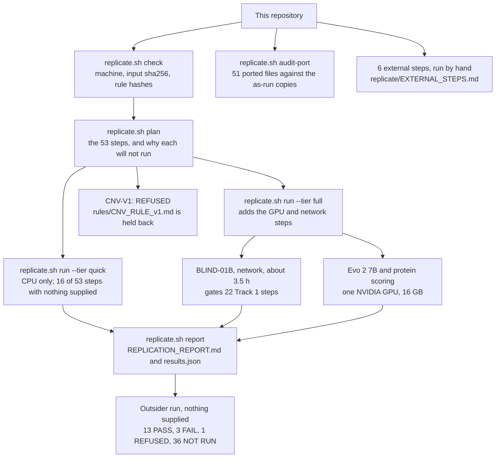

# MVA Hackathon 2026: analysis code (Team DETA)

The analysis code, replication harness and pre-registration records behind Team DETA's two reports for the SageBio
MVA Hackathon 2026 (mosaic variegated aneuploidy).

[](LICENSE)
[](NOTICE)
[](env/requirements-quick.txt)
[](tests)
[](#what-was-tested)
[](replicate/expected.yaml)
[](#what-an-outsiders-quick-tier-runs)
[](#what-an-outsiders-quick-tier-runs)

Code for our entry to the SageBio MVA Hackathon 2026 (mosaic variegated aneuploidy).
Track 1: interpretation of one child's whole-genome data under pre-registered, hashed rules.
Track 2: therapeutic hypotheses tested against public data (DepMap 24Q4, literature checks).

This repository accompanies the submission of Team DETA to the SageBio "Rare Disease, Real Kid" MVA Hackathon 2026.
Code and documentation alike: CC BY 4.0, the licence the release terms place on participant submissions, so that the
methods here can be reused for any other undiagnosed individual. Both submitted reports are in `reports/`, each as the
PDF that was submitted and as the Markdown it was built from.

Open question, not ours to settle: the organisers' own discussion thread about incidental findings under CC BY 4.0
is unresolved, and their current guidance there is to keep repositories private. This repository stays private
until the hackathon closes; before it is made public, someone must check whether that thread has been resolved, and
if it has not, publication waits for an explicit decision by the team, not by whoever runs the publication step.

## Results at a glance

| | |
|---|---|
| Track 1, row 1 | BUB1B c.2210T>G p.(Leu737Ter) with c.3006T>G p.(Asn1002Lys), submitted with moderate confidence. Phase was not measured, so the compound-heterozygous configuration is a hypothesis |
| Track 1, what was submitted | ten ranked rows, restated in Section 2 of `reports/DETA_track1_report.md`; the sha256 of the submitted CSV is in that report's Reproducibility paragraph |
| Track 2 | the conclusions are in that report's abstract, and each traces to its pre-registration ledger (Section 12 of `reports/DETA_track2_report.md`) |
| How the decisions were fixed | pre-registered rules frozen in `rules/` with their sha256 in `rules/SHA256SUMS.txt`; the harness refuses a step whose rule file does not match its hash |
| What a reader can run | 16 of the harness's 53 steps with only this repository, the organisers' VCF, a BAM and the public references: CPU only, about 8 minutes. Three of the 16 need nothing at all, not even the dataset: two re-derive the submitted EPCR column and the adopted row-building rule from the published counts, and the third is the Track 2 power guide |
| What that run produced | 13 PASS, 3 FAIL, 1 REFUSED, 36 NOT RUN. Every metric of every step that ran is identical to our run; the 3 FAILs are register differences our own run shows too |
| What our own run reaches | 41 of 53 steps in the quick tier, about 11 minutes, with all four of these supplied: our five stored child-derived intermediates, the Evo 2 control scores shipped in `intermediates/`, our stored protein scores, and the held-back CNV rule |
| What each remaining step needs | BLIND-01B (network, about 3.5 h) and the 22 Track 1 steps that need its output, 4 GPU steps and the calibrations that read their scores, CNV-V1 (rule held back), T2-TRIAL-01 (live registry) and the 6 external steps. Orientation states what each one needs in full |
| Tests | 73 pytest tests on synthetic data, including an end-to-end run and a scan of every file for sequencing data, local paths and secrets |

## Contents

- [Results at a glance](#results-at-a-glance)
- [What was tested](#what-was-tested)
- [Orientation](#orientation)
  - [Reproducing this work: what counts as agreement](#reproducing-this-work-what-counts-as-agreement)
- [The replication flow](#the-replication-flow)
- [Before you start](#before-you-start)
- [What is in this repository](#what-is-in-this-repository)
- [What is deliberately not in this repository](#what-is-deliberately-not-in-this-repository)
- [Replicating this work](#replicating-this-work)
  - [1. Folders and Python environment](#1-folders-and-python-environment)
  - [2. The organisers' data](#2-the-organisers-data)
  - [3. Every external input](#3-every-external-input)
  - [4. Run](#4-run)
  - [What an outsider's quick tier runs](#what-an-outsiders-quick-tier-runs)
  - [Requirements](#requirements)
  - [What the harness guarantees](#what-the-harness-guarantees)
  - [Steps and expected runtimes](#steps-and-expected-runtimes)
  - [What PASS means](#what-pass-means)
  - [Disclosed deviations](#disclosed-deviations)
- [Layout](#layout)
- [How to rerun (order)](#how-to-rerun-order)
- [Held back](#held-back)
- [Disclosure of AI assistance](#disclosure-of-ai-assistance)
- [Acknowledgement](#acknowledgement)
- [License](#license)

## What was tested

The rules and decision criteria were frozen and hashed before they ran, and then tested against events whose answer
was known. The table inventories that work and names the file each figure comes from, negative results included.

| what was tested | scale | result | where the figures are |
|---|---|---|---|
| Ranking rules, out of sample: public ClinVar Pathogenic/Likely pathogenic alleles written into the child's own background, the frozen rules rerun per trial | 1,611 trials over eight pre-registered strata (`A-pc` adds no trials: it is a subset of the primary stratum) | Primary stratum rank-1 recall **0.533 [0.477, 0.589]** against a pre-registered bar of 0.80, so **the pre-registered bar was not met** (the register's own label for the hypothesis is FALSIFIED). Other BUB1B pairs 1.000 [0.975, 1.000]. With ClinVar hidden, rank 1 drops to 0.000 [0.000, 0.008] while the top 10 holds 0.790 [0.741, 0.833]. The specificity result is the pair of control strata: recessive genes **with** a phenotype match reach 0.857 [0.814, 0.893] over 300 trials, recessive genes **without** one reach 0.010 [0.003, 0.026] over 300. Stop-loss alleles were labelled `stop_lost` in 0 of 311, a blind spot the methods state | `preregistration/spikein/RESULT.md` (every figure with its interval, the decisions and the limits); `preregistration/frozen/PRE_REG_SPIKEIN_EPCR.md` section 6 (the strata and their sizes); `reports/DETA_track1_report.md` section 6. Reproducible here: `./replicate.sh run --steps PRE-REG-SPIKEIN-G1,PRE-REG-SPIKEIN-TRIALS,PRE-REG-SPIKEIN` rebuilds the trials and checks 67 recorded values against `replicate/expected.yaml`. With no dataset at all, PRE-REG-SPIKEIN-EPCR-CHECK re-derives the submitted EPCR column from the published counts |
| An independent rebuild of those trials | 83 rebuilt by hand at the time; all 1,611 rebuilt by the harness since | 83 of 83 matched by hand. The harness now rebuilds the whole trial table from the organisers' VCF and the pinned ClinVar release and reproduces it byte for byte (metrics `sha256_trials` and `sha256_alleles`), so the spike-in is checkable rather than attested | `reports/DETA_track1_report.md` section 6; step PRE-REG-SPIKEIN-TRIALS in `replicate/expected.yaml` |
| The row-building rule, chosen rather than assumed: six rules under three row constructions, every trial file scored with the organisers' unmodified `evaluation.py` | 779 trials over 201 genes | The adopted rule (P5 with construction C3) scores **80.2 mean rank points [73.3, 86.8]** against **49.1 [44.8, 53.4]** for the draft rule it replaced, and puts the exact pair on row 1 in 0.626 [0.592, 0.660] of trials against 0.095 [0.076, 0.117] | `preregistration/rowmap/RESULT.md` (every figure, the secondary strata and the near-tie); `preregistration/frozen/PRE_REG_ROWMAP.md`; `reports/DETA_track1_report.md` section 6. To corroborate, follow PRE-REG-ROWMAP in `replicate/EXTERNAL_STEPS.md`, which records what was measured when we tried to make it a harness step and why gate S-R4 defeats that; with no dataset at all, PRE-REG-ROWMAP-CHECK re-applies the decision rule to the published points distributions |
| Our own written record, against the code that produced it | 53 harness steps, 52 of them with register entries, 501 expected metric values | **The harness found errors in our own record.** A quick-tier run executed 34 of the 46 steps the harness had then (28 PASS, 6 FAIL) and matched **312 of 322 expected metric values**. The ten that differed fall in six steps (four in H01, two in C-FIX-01-FU, one each in H-BATCH, RANK-V2F, P1 and M-PROT-CAL-02-BUILD) and produced errata **E1 to E6**, each naming the register entry it corrects and leaving that entry unedited; the entry's conclusion holds in all six. Three further errata are not corrections of that kind: **E7** corrects a manifest entry that sits outside the register, **E8** revises the counting definition behind a withdrawn figure and its conclusion holds only in part, and **E9** corrects nothing but records the scope that twelve unrun GPU and network steps leave unverified. That run belongs to harness commit 2380353, so its counts do not line up with this tree's 53 steps and 501 expected values. Rerun at this commit with everything supplied, the quick tier executes 41 steps and compares 470 expected metric values: 460 match, and the ten that differ are the same ten, in the same six steps, so E1 to E6 stand as written. To corroborate, run the quick tier yourself and compare against `replicate/expected.yaml`, which ships | `replicate/expected.yaml`; `preregistration/REDACTED_PREREG_LOG_SELF_RECORDED.md` section 6 |
| Our own instrument, by extending it | one artifact declaration, and the one step that already depended on it | Building the spike-in steps surfaced a defect in the harness: the artifact `child_exonic_calls` was declared as a folder containing that file rather than as the file itself, so `exact_if` on it could never match. The one step that already depended on it, BLIND-01B, was therefore reporting its metrics NOT COMPARABLE while the file was in fact byte-identical to our stored output. Fixed in `replicate/registry.py`; no expected value was changed, and nothing else in the harness referenced that artifact. It is a comparison that was never performed, not a wrong number, so it is reported here rather than as an erratum to the register | `replicate/registry.py`; the step list in `replicate/expected.yaml` |
| The repository, by someone who had not built it: cloned and run from the README alone | 13 steps executed in common with our own run | Every step both runs executed agreed in status, with byte-identical observed values for every metric. The same exercise found documentation defects, which section 1 and the external-input table now answer | clean-room replication of 2026-10-20, held by the authors |
| Every reference in both reports, resolved against live databases | 108 distinct PMIDs across the two reports; 99 verbatim quotations re-derived | All 108 resolve to a PubMed record, so none is invented, and none is retracted or under an expression of concern. 98 of the 99 quotations are exact; the exception is a figure-level quote whose full text PMC does not serve. The same check returned corrections to both reports, which they carry in their own corrections sections | the resolution is shipped and re-runnable: `references/BIBLIOGRAPHY.md`, `references/bibliography.json` and one folder per work under `references/papers/`, all rebuilt by `python3 citations/collect_references.py`. The quotation re-derivation of 2026-10-20 is a record held by the authors |
| Proposed mechanism classes, screened on direction, dependency and exposure with the verdict definitions fixed in advance | 25 verdict rows over 24 classes; 226 molecule rows; 60 dependency targets measured | 11 excluded, 6 never tested against BUBR1, 8 open, 6 of the 8 bearing directly on raising BUBR1. The screen removed the published basis for two of the arms we were carrying. One slice of about 45 proteostasis and chaperone molecules was never evaluated drug by drug, and that coverage gap falls on two of those arms | `reports/DETA_track2_report.md` sections 12 and 15 |
| Our own instruments, where they could be checked | a genome-wide screen over 17,916 genes; criterion C4 | The genome-wide null is relabelled a property of the rule rather than of the biology: the threshold excludes the screen's own positive control at +0.192, and the test had power 0.514 against its own pre-registered minimum effect. Criterion C4 failed its own validity test and is reported as non-discriminating | `reports/DETA_track2_report.md` sections 9.3 and 9.4 |

Two of these results run against us and are kept in full rather than summarised away: the ranking rules miss the
pre-registered rank-1 bar, and the consequence classifier never labels a stop-loss allele as one. Both are stated
with their measured values in the Track 1 report, and the second appears in the table above as 0 of 311.

## Orientation

- What this is: the code, replication harness and records behind Team DETA's two reports, `reports/DETA_track1_report.md`
  (Track 1, one child's whole genome) and `reports/DETA_track2_report.md` (Track 2, therapeutic mechanisms).
- What was concluded: Track 1 row 1 is BUB1B c.2210T>G p.(Leu737Ter) with c.3006T>G p.(Asn1002Lys), submitted with
  moderate confidence; phase was not measured, so the compound-heterozygous configuration is a hypothesis. Track 2's
  conclusions are in its abstract, and each traces to its pre-registration ledger (Section 12 of that report).
- Where the answer lives: Track 1 report, Section 1 (answer and confidence) and Section 2 (the ten submitted rows,
  restated); the sha256 of the submitted CSV is in its Reproducibility paragraph.
- Where the pre-registrations live: the frozen rule files in `rules/` (sha256 in `rules/SHA256SUMS.txt`, checked by
  the harness), every pre-registration text with its freeze time in `preregistration/REDACTED_PREREG_LOG_SELF_RECORDED.md`,
  and two frozen files kept outside the register in `preregistration/frozen/`.
- What runs with only this repository, the organisers' VCF, a BAM and the public references: 16 of the harness's 53
  steps, CPU only, about 8 minutes (see "What an outsider's quick tier runs").
- What cannot run that way, and what each one needs: BLIND-01B needs network access and about 3.5 h; the 22 Track 1
  steps downstream of it need its output, a per-variant table of the child that we do not ship; 4 GPU steps need one
  16 GB NVIDIA GPU and the full environment, and the 2 calibrations that read their scores need those scores (one of
  them runs with the file shipped in `intermediates/`); CNV-V1 needs `rules/CNV_RULE_v1.md`, which is held back;
  T2-TRIAL-01 needs the live registry; and the 6 external steps are run by hand, with their procedures in
  `replicate/EXTERNAL_STEPS.md`.
- Where the limits are: "Disclosed deviations" and "Held back" below, Sections 1 and 3.2 of the pre-registration log,
  and the limitations sections of both reports.

### Reproducing this work: what counts as agreement

Two kinds of step need two standards.

The scripted steps are deterministic: fixed seeds, pinned versions, hashed weights. The harness compares each metric
against the value we recorded and prints both. A difference there is a difference, and the table says so.

The remaining steps apply written criteria to published sources. Rerunning them, with our model or another, can yield
different wording and, at a threshold, a different verdict. Agreement is therefore not textual. Each of these steps
ships the criterion, hashed before the sources were opened, and the quotation it was applied to. The test is whether
the criterion was applied to that evidence, not whether the sentences match.

A different verdict from the same criterion and the same quotation is evidence about the criterion. Report it.

## The replication flow

One entry point, `./replicate.sh`, covers the whole harness. The diagram shows which parts of it an outsider can
reach and which parts need something this repository does not ship.



## Before you start

You must have: Linux x86_64; Python 3.12 or later (we used 3.13.5); bash, zcat, awk, head and tabix, and samtools
once (to index the FASTA); 5 GB of available RAM; about 26 GB free where the workdir goes (`check` asks for the plan's
disk budget, under 1 GB, plus a 5 GB margin above a 20 GB floor that is never crossed); no GPU for the quick tier.

You must download (sizes and URLs in section 3 below): the organisers' VCF and its index (about 318 MB, with
`tools/dl.py`, after accepting the dataset's terms on Hugging Face); the quick-tier public references (about 1.6 GB);
the 7-package Python environment (about 310 MB). You also need a BAM: ours on request (110 GB), or your own from the
alignment step ALIGN-01 (the 85 GB of FASTQs, one NVIDIA GPU, Docker; 82 min on our RTX 3090; see
`replicate/EXTERNAL_STEPS.md`). The full tier adds about 20 GB of model weights and the 6.9 GB full environment.

How long it takes, measured on our machine: hashing the BAM about 1.5 minutes the first time; the outsider's quick
tier about 8 minutes in total; BLIND-01B about 3.5 hours (network). Download times were not measured.

Export the environment variables before the first command. `config.example.yaml` writes its paths with
`${MVA_WORK}`, `${MVA_DATA}`, `${MVA_REF}` and `${MVA_MODELS}` (`MVA_REF`, singular), and the first command stops
before it starts if `MVA_WORK` is unset:

```
$ ./replicate.sh plan --config config.example.yaml
config error: environment variable MVA_WORK is used in the config but not set
```

`MVA_WORK` is the one that stops the command, because `workdir` is the only use of a variable outside `inputs:`.
`MVA_DATA`, `MVA_REF` and `MVA_MODELS` resolve input paths instead, and an input whose variable is unset is left
unconfigured on purpose and listed by `check`. So a quick-tier run needs `MVA_WORK`, `MVA_DATA` and `MVA_REF`
exported and can leave `MVA_MODELS` unset; the `export` lines are in section 1 below.

Preflight: `./replicate.sh check --tier quick` checks the machine (OS, Python and package versions, tools, RAM, free
disk at the workdir, and the GPU, driver and torch when a GPU step is selected), hashes every configured input against
`replicate/expected.yaml`, checks the rule-file hashes, and prints PASS, WARN or FAIL per item: for a missing input,
which steps need it (where to get it is in section 3), and for a missing intermediate, how to obtain it.
`./replicate.sh plan --tier quick` then lists every step and, for each one that will not run, why.

## What is in this repository

| purpose | where | what it is |
|---|---|---|
| Replication harness | `replicate.sh`, `replicate/` | one entry point (`check`, `plan`, `run`, `report`, `audit-port`) for 53 steps, each named after the register entry it reproduces (or marked as a harness or external step); `replicate/expected.yaml` holds every expected value, tolerance, input sha256 and download URL; writes only to a workdir outside the repository; `replicate/EXTERNAL_STEPS.md` gives the procedures of the six steps it does not run |
| Analysis code that the harness runs | `replicate/analysis/` | the 51 ported files (50 analysis scripts and the Evo 2 config) as they ran, with only the lines listed in `PORTING_LOG.md` changed (paths become config inputs, the candidate is read at run time); `replicate/analysis/PORTING.json` logs every changed line |
| Analysis code as it ran (records) | `as_run/`, `citations/` | the original scripts, verbatim except where a local user, disk or session name became `[redacted]` (and two lines of `citations/t1_rows.py` that cite internal research notes); not run (`as_run/README.md`). Includes the two pre-registered spike-in tests (`as_run/track1/spikein/`, `as_run/track1/rowmap/`), the Track 2 HDAC-screen DepMap cross-check (`as_run/track2/hdac_screen/`) and the structural-prediction scripts (`as_run/track2/structural_prediction/`) |
| Frozen rules and their hashes | `rules/` | the pre-registered decision rules (ranking v1 to v4, SV v1, calibration) and `SHA256SUMS.txt`; the harness refuses a step whose rule file does not match its hash |
| Tools | `tools/` | dataset download, exon BED builder, alignment launcher, the porting script, and the public-export and leak-scan tools |
| Environment | `env/` | quick-tier lock (7 packages), full freeze (99 packages) with install order, container digests |
| Public-derived intermediates | `intermediates/` | Evo 2 scores of the 198 ClinVar calibration controls (no child data), so the quick tier can run the Evo 2 calibration without a GPU; the control set and scores of the external Borzoi step (public positions only), so that step can be checked against exactly our variants |
| Shipped reference | `references/` | the bibliography of every work cited in either report, 108 of them, one folder each with the PubMed record and the licence, full text where the licence permits (`references/BIBLIOGRAPHY.md`); and the ClinGen gene curation list release that SV-MANTA read (CC0 1.0), because upstream replaces that file at each release (`references/README.md`) |
| Tests | `tests/` | 73 pytest tests on synthetic data, including an end-to-end run and a scan of every file for sequencing data, local paths and secrets |
| Pre-registration log | `preregistration/REDACTED_PREREG_LOG_SELF_RECORDED.md` | what we pre-registered and when, as we recorded it: the frozen files with sha256 and freeze times, the full pre-registration texts (read-level values removed), and for each result the rule it applied; its checkpoints show that lines were not edited later, not when they were written (times are self-recorded, not notarised) |
| Frozen pre-registrations kept outside the register | `preregistration/frozen/` | the two frozen texts the spike-in tests ran under: `PRE_REG_SPIKEIN_EPCR.md` (unchanged; step PRE-REG-SPIKEIN-TRIALS hashes this shipped file and checks it against the hash the run recorded) and `PRE_REG_ROWMAP.md` (public copy: the passages that cite the authors' internal research notes are not reproduced, every rule definition unchanged; the frozen original's sha256 is in the log), with `SHA256SUMS.txt` for the shipped files |
| The submitted answer as a file | `preregistration/rowmap/TRACK1_SUBMISSION_ROWMAP_PROPOSED.csv` | the 10-row CSV we submitted, byte for byte (sha256 `a349d642fb4597ea2ebe1b032cf40e3ea2b962e80860e7cc9538164944d78e4f`, the value the Track 1 report quotes). It keeps the name the ROW-MAP test gave it, because that test produced it and `preregistration/rowmap/RESULT.md` records it under that name. Diff it against the row table in `reports/DETA_track1_report.md` rather than retyping either |
| Results of the pre-registered tests | `preregistration/spikein/`, `preregistration/rowmap/` | each test's RESULT, its deviations from the pre-registration, its timestamped run log and its aggregate output (`summary*.json`, `sanity*.json`, the gate record `val_G1.json`, the feasibility counts). Trial counts, recalls and intervals only: the per-trial tables and the row-level outputs are not here (see "What is deliberately not in this repository") |
| The submitted reports | `reports/` | `DETA_track1_report.md` and `DETA_track2_report.md`, the Markdown sources of the submitted PDFs |
| Licences | `LICENSE`, `NOTICE` | everything here, code and documentation alike, CC BY 4.0; third-party material keeps its own licence, each named in `NOTICE` (AlphaMissense, the evo2 config, the Borzoi weights, the GTEx-derived Borzoi control set, the ClinGen list); the retrieved publication records under `references/papers/` carry their publishers' copyright |

## What is deliberately not in this repository

Every row names what a replicator needs instead, so the requirement is visible rather than the absence. The privacy
statement after the table says what is here on purpose.

| what | why | how a replicator gets it |
|---|---|---|
| The child's VCF and FASTQs | organisers' data; their terms forbid redistribution | Hugging Face `SageBio/mva-hackathon-2026-data` at commit 59e322d (`tools/dl.py`) |
| Our BAM (alignment of those FASTQs) | genotype-scale patient data | from the authors on request (sha256 in `expected.yaml`), or `tools/fq2bam.sh` |
| Every genotype-scale or per-variant table of the child (exonic calls, consequence tables, rankings, read-level outputs) | patient data | produced in your workdir when you run the harness; their sha256 are in `expected.yaml` |
| gnomAD frequency parts (`gnomad_parts`) | a per-variant table of the child | regenerate with BLIND-01B (network, about 3.5 h), or the authors' copy if the organisers approve |
| Protein-model scores (`protein_scores`) | they hold the candidate's row | regenerate with M-PROT-CAL-02-SCORE (GPU), or the authors' copy if the organisers approve |
| `rules/CNV_RULE_v1.md` (only its sha256 is here) | its frozen text contains a local file name, and editing it would break its hash | from the authors on request; CNV-V1 is refused without it |
| The hypothesis register | it holds read-level values and the full working record rather than only the submitted content | not shipped; `preregistration/` holds its pre-registration content |
| ThermoMPNN, protein structures and calibration data of the structural-prediction scripts | third-party software and data | from their sources; the scripts take a work folder as an argument |
| The authors' unredacted originals and the HMAC key of `PORTING.json` | they contain our local user names and paths | kept by the authors; with them `audit-port --key-file` checks the full originals |
| Per-trial tables of the two spike-in tests (`trials.tsv`, `alleles.tsv`, `trials_rowmap.tsv`, `real_rows.tsv`) and the two proposed CSVs | bulk, and `real_rows.tsv` and the draft CSV hold rows of the child's calls that are not part of our published answer | the first two are rebuilt byte for byte by PRE-REG-SPIKEIN-TRIALS in your workdir; the aggregates of all of them ship in `preregistration/spikein/` and `preregistration/rowmap/` |
| The organisers' scorer (`evaluation.py`) | it is their code, not ours | from the challenge Space at the commit named in `replicate/EXTERNAL_STEPS.md` (PRE-REG-ROWMAP) |
| Public references and model weights | size and their own terms | download them (URLs, releases and sha256 in `expected.yaml`; see section 3 below) |

Privacy statement. This repository contains our analysis, our documentation and the candidate variant coordinates,
protein changes and proband label that constitute our Track 1 answer; they appear in the Track 1 report, the as-run
scripts, the frozen pre-registrations and the pre-registration log. It does not contain the child's
sequencing data in any form: no VCF, FASTQ or BAM, no genotype-scale or per-variant table of the child's calls, no
gnomAD frequency table or protein-model score table of the child's variants, no read-level values, and not the
hypothesis register. The organisers' terms forbid redistributing their data files, and everything at that scale is
derived from them. `tools/leak_scan.py` fails on sequencing-data files, local user and machine names, private
addresses and secrets, and reports, without failing, every place where the candidate's coordinates, protein change
or proband label appear. Also present on purpose: the organisers' own file names (as on their public dataset card),
the organisers' eight HPO phenotype terms (inside the frozen rule `rules/RANKING_RULE_v4.md` and the ranking scripts),
and public annotation coordinates (gene spans, one dbSNP site).

## Replicating this work

The harness is one entry point that checks the machine, shows the step graph, runs the analyses the way we ran
them, guards disk, memory and GPU, and writes one report that compares every result with the value we recorded
before seeing it. The commands below are the whole procedure for the quick tier (CPU only).

### 1. Folders and Python environment

```
git clone <this repository> mva-repo && cd mva-repo
export MVA_DATA=/path/to/mva-hackathon-2026-data   # the organisers' dataset (step 2)
export MVA_REF=/path/to/references                 # public references (step 3)
export MVA_WORK=/path/to/scratch                   # your BAM and the harness workdir go here
export MVA_MODELS=/path/to/models                  # full tier only; leave unset for the quick tier

python3.13 -m venv $MVA_WORK/venv-quick
$MVA_WORK/venv-quick/bin/pip install -r env/requirements-quick.txt     # 7 pinned packages, about 310 MB
export REPLICATE_PYTHON=$MVA_WORK/venv-quick/bin/python
```

`config.example.yaml` uses these four variables. An input whose path uses an unset variable (for example the
model weights under `MVA_MODELS` in a quick-tier run) is left unconfigured, and `check` lists it. For the full
tier, build the full environment instead (order matters; see `env/README.md`):

```
python3.13 -m venv $MVA_WORK/venv-full
$MVA_WORK/venv-full/bin/pip install torch==2.14.1 --index-url https://download.pytorch.org/whl/cu130
$MVA_WORK/venv-full/bin/pip install --no-deps -r env/requirements-full-binary.txt
$MVA_WORK/venv-full/bin/pip install --no-deps --no-build-isolation flash_attn==2.8.3.post2 transformer_engine_torch==2.20.2
export REPLICATE_PYTHON=$MVA_WORK/venv-full/bin/python                # about 6.9 GB; CUDA 13 toolkit needed to build
```

`pip install -r env/requirements_freeze.txt` alone fails: flash_attn and transformer_engine_torch are CUDA source
builds that need torch at build time.

### 2. The organisers' data

Hugging Face dataset `SageBio/mva-hackathon-2026-data`, commit `59e322d27f399006b398d366d33e703e48a29914`
(a later commit, 9f155b0, changed only the README). Accept the dataset terms, log in (`hf auth login` or
`HF_TOKEN`), then:

```
$MVA_WORK/venv-quick/bin/pip install huggingface_hub==0.36.2       # only for the download
$REPLICATE_PYTHON tools/dl.py --local-dir $MVA_DATA --vcf-only     # the VCF and its .tbi; drop --vcf-only for all 11 files (85 GB)
```

Files used: `WGS_EX2312012_HGWCNDSX7.vcf.gz` and `WGS_EX2312012_HGWCNDSX7.vcf.gz.tbi` (names as on the dataset
card; config inputs `vcf`, `vcf_tbi`) and, for the alignment only, the eight FASTQs of the same dataset (lanes
L001 to L004, R1 and R2). The organisers' terms require deleting the data after the event; do not commit any file
derived from it at genotype scale (VCF, BAM/CRAM, FASTQ, per-variant tables).

The BAM (input `bam`, put at `$MVA_WORK/alignment.bam` with its `.bai` next to it) is our GRCh38 alignment of
those FASTQs. It is not redistributed (data terms). Two ways to get one:

1. Ask the authors for our BAM (110 GB; sha256 `9b92f9db6aebf383...`, full value in `replicate/expected.yaml`).
   With it every BAM-derived metric is compared exactly.
2. Align the FASTQs yourself (step ALIGN-01; full procedure in `replicate/EXTERNAL_STEPS.md`) with
   `tools/fq2bam.sh $MVA_DATA $MVA_REF/GCA_000001405.15_GRCh38_no_alt_plus_hs38d1_analysis_set.fna $MVA_WORK/align PROBAND01`
   (Parabricks 4.7.1-1 fq2bam, container digest in `env/containers.txt`; Docker with the NVIDIA container toolkit;
   NCBI's prebuilt BWA index extracted next to the FASTA). Our run used 13.7 to 14.0 GB of GPU memory and took
   82 min 6 s on one RTX 3090; its peak host RAM and temporary disk were not recorded. The script is our launcher
   with its local paths made into arguments; it has only been checked with `bash -n`, never run. A fresh BAM is not
   byte-identical to ours, so the harness reports BAM-derived counts as NOT COMPARABLE and compares only the
   pre-registered decisions (each metric's `tol_alt` in `expected.yaml`).

### 3. Every external input

Every file and service the replication reads, with its config input (or the step that uses it when it has none).
Files with a config input go under the names shown; `check` hashes each one against `replicate/expected.yaml`,
which also holds the URLs. `tools/dl.py` fetches only the organisers' files; everything else comes from the URL shown.
Sizes are in bytes unless stated; where a size or licence is not recorded anywhere, the table says so.

<details>
<summary>The full table: 28 rows, each with its config input, source, version, size and terms</summary>

| input | config input (file) | where to get it | version or release | size | licence or terms |
|---|---|---|---|---|---|
| organisers' variant calls and index | `vcf`, `vcf_tbi` (`$MVA_DATA/WGS_EX2312012_HGWCNDSX7.vcf.gz`, `.tbi`) | organisers: Hugging Face `SageBio/mva-hackathon-2026-data` (gated); `tools/dl.py --local-dir $MVA_DATA --vcf-only` | dataset commit `59e322d27f399006b398d366d33e703e48a29914` | 315,153,971 and 2,343,376 | the organisers' terms: no redistribution; delete after the event |
| organisers' FASTQs, 4 lanes, R1 and R2 | none; ALIGN-01 (`tools/fq2bam.sh` finds them in `$MVA_DATA`) | organisers, same dataset; `tools/dl.py --local-dir $MVA_DATA` | same commit | about 85 GB in total | same |
| organisers' clinical phenotype document (`Challenge_Clinical_Phenotype_1.docx`) | none: its eight HPO terms are written into `rules/RANKING_RULE_v4.md` and the v4 ranking scripts | organisers, same dataset; `tools/dl.py` without `--vcf-only` | same commit | 16,865 | same |
| our BAM and `.bai` | `bam` (`$MVA_WORK/alignment.bam`) | the authors, on request; or align with ALIGN-01 (`replicate/EXTERNAL_STEPS.md`) | Parabricks 4.7.1-1 fq2bam | about 110 GB | child's data: not redistributed |
| `CNV_RULE_v1.md`; `gnomad_parts`; `protein_scores` | `rules_extra_dir`; `intermediates` | the authors, on request (the two tables only if the organisers approve); or recompute with BLIND-01B and M-PROT-CAL-02-SCORE | sha256 in `rules/CNV_RULE_v1.sha256` and `expected.yaml` | not recorded | rule text: CC BY 4.0, like the other rule texts; tables: child's data |
| GRCh38 analysis set FASTA and `.fai` | `fasta` (`$MVA_REF/GCA_000001405.15_GRCh38_no_alt_plus_hs38d1_analysis_set.fna`, `.fai` next to it) | `https://ftp.ncbi.nlm.nih.gov/genomes/all/GCA/000/001/405/GCA_000001405.15_GRCh38/seqs_for_alignment_pipelines.ucsc_ids/` + the file name + `.gz` (gunzip) and `.fai` (we used NCBI's; `samtools faidx` also makes one) | GCA_000001405.15 | 874,637,925 compressed; 123,147 (`.fai`) | NCBI: no restrictions on use or distribution |
| BWA index of that FASTA | none; ALIGN-01 only | same folder, file name + `.bwa_index.tar.gz`, extracted next to the FASTA | same | 3,451,512,197 | NCBI, as above |
| GENCODE v44 basic annotation | `gtf` (`gencode.v44.basic.annotation.gtf.gz`) | `https://ftp.ebi.ac.uk/pub/databases/gencode/Gencode_human/release_44/gencode.v44.basic.annotation.gtf.gz` | release 44; downloaded 2026-10-17 | 29,570,410 | GENCODE: open access |
| protein-coding exon BED | `exon_bed` (`protein_coding_exons_hg38.bed`) | built: `$REPLICATE_PYTHON tools/build_exon_bed.py --gtf $MVA_REF/gencode.v44.basic.annotation.gtf.gz --out $MVA_REF/protein_coding_exons_hg38.bed` (byte-identical to the file we used) | from GENCODE 44 | 19,345,803 | derived from GENCODE |
| ClinVar GRCh38 VCF | `clinvar_vcf` (`clinvar.vcf.gz`) | `https://ftp.ncbi.nlm.nih.gov/pub/clinvar/vcf_GRCh38/archive_2.0/2026/clinvar_20261011.vcf.gz`, saved as `clinvar.vcf.gz` | release 2026-10-11 (the file's `##fileDate`); downloaded 2026-10-17 | 200,437,060 | NCBI, as above |
| HPO ontology and gene annotations | `hpo_obo`, `hpo_genes_to_phenotype` (`hp.obo`, `genes_to_phenotype.txt`) | `https://github.com/obophenotype/human-phenotype-ontology/releases/download/v2026-09-01/` + file name | v2026-09-01; downloaded 2026-10-18 | 10,863,613 and 20,821,704 | HPO licence (`https://hpo.jax.org/app/license`) |
| DepMap 24Q4 gene effect and models | `depmap_gene_effect`, `depmap_model` (`depmap_24Q4/CRISPRGeneEffect.csv`, `depmap_24Q4/Model.csv`) | `https://ndownloader.figshare.com/files/51064667` and `https://ndownloader.figshare.com/files/51065297` (Figshare record 27993248, `https://doi.org/10.25452/figshare.plus.27993248`) | DepMap Public 24Q4 | 428,678,699 and 645,696 | CC BY 4.0 |
| ClinGen gene curation list, GRCh38 | `clingen_gene_curation` (`ClinGen_gene_curation_list_GRCh38.tsv`); SV-MANTA only | shipped: `references/ClinGen_gene_curation_list_GRCh38.tsv`, our unmodified copy (sha256 in `expected.yaml`). Upstream, `https://ftp.clinicalgenome.org/ClinGen_gene_curation_list_GRCh38.tsv` serves a file replaced at each release, and we found no archive, so this release cannot be re-fetched from there | release of 16 Oct 2026; downloaded 2026-10-17 | 249,270 | CC0 1.0 (attribution in `NOTICE`) |
| UCSC hg38 chromosome 15 | none; M-REG-BORZOI | `https://hgdownload.soe.ucsc.edu/goldenPath/hg38/chromosomes/chr15.fa.gz` | hg38 | 27,201,183 | UCSC: free for public use |
| AlphaMissense predictions (full tier) | `alphamissense` (`AlphaMissense_hg38.tsv.gz`) | `https://zenodo.org/records/10813168/files/AlphaMissense_hg38.tsv.gz` | Zenodo record 10813168 | 642,961,469 | CC BY 4.0 (see the note below the table) |
| ESM-1v weights (full tier) | `esm1v_dir` (`$MVA_MODELS/esm1v_t33_650M_UR90S_1`) | Hugging Face `facebook/esm1v_t33_650M_UR90S_1`, revision `8bfdb1892536cc77bd0760b9c25ddced2cd0b4c8` (snapshot folder) | that revision; downloaded 2026-10-19 | 2,609,603,341 | MIT (upstream `facebookresearch/esm`; the Hugging Face repository has no licence tag) |
| ESM-2 weights (full tier) | `esm2_dir` (`$MVA_MODELS/esm2_t33_650M_UR50D`) | Hugging Face `facebook/esm2_t33_650M_UR50D`, revision `08e4846e537177426273712802403f7ba8261b6c` | that revision; downloaded 2026-10-19 | 2,609,506,392 (`model.safetensors`) | MIT, as above |
| Evo 2 7B weights (full tier) | `evo2_weights` (`$MVA_MODELS/evo2_7b/evo2_7b.pt`) | Hugging Face `arcinstitute/evo2_7b`, revision `bda0089f92582d5baabf0f22d9fc85f3588f6b58`, file `evo2_7b.pt` (sha256 checked before loading) | that revision; downloaded 2026-10-19 | 13,766,621,200 | Apache-2.0 |
| Borzoi weights | none; M-REG-BORZOI (our control set and scores: `intermediates/borzoi_control_scores.tsv`) | Hugging Face `johahi/borzoi-replicate-0`, revision `521db103372769581b8d1d616e6a3b496da490c5` | that revision; downloaded 2026-10-19 | 743,692,788 (`model.safetensors`) | CC BY 4.0 (attribution in `NOTICE`) |
| gnomAD v4.1 exome sites VCFs, read by byte range | none; BLIND-01B (network) | `https://gnomad-public-us-east-1.s3.amazonaws.com/release/4.1/vcf/exomes/gnomad.exomes.v4.1.sites.{chrom}.vcf.bgz` and `.tbi` | v4.1; read 2026-10-17 | read in parts, not downloaded | see `https://registry.opendata.aws/broad-gnomad/` |
| ClinicalTrials.gov API v2 | none; T2-TRIAL-01 (network) | `https://clinicaltrials.gov/api/v2/studies` | live registry; queried 2026-10-20 | service | not recorded |
| GTEx API v2 | none; M-REG-BORZOI (network) | `https://gtexportal.org/api/v2` (`/reference/gene`, `/association/singleTissueEqtl`) | dataset `gtex_v8`, GENCODE v26; queried 2026-10-19 | service | not recorded |
| Ensembl REST | none; H13-SMN (network) | `https://rest.ensembl.org` (`/lookup/symbol`, `/sequence/region`) | release not recorded; queried 2026-10-17 | service | Ensembl: no restrictions on use |
| openFDA | none; T2-CLASS-01 (network) | `https://api.fda.gov/drug/drugsfda.json`, `https://api.fda.gov/drug/label.json` | live; queried 2026-10-20 | service | CC0 1.0 |
| PubMed (E-utilities) and ChEMBL | none; T2-CLASS-01 (network) | `https://eutils.ncbi.nlm.nih.gov/entrez/eutils/`; `https://www.ebi.ac.uk/chembl/api/data/activity.json` | live; queried 2026-10-20 | service | NCBI as above; ChEMBL not recorded |
| Parabricks container | none; ALIGN-01 | `nvcr.io/nvidia/clara/clara-parabricks:4.7.1-1`, digest in `env/containers.txt` | 4.7.1-1 | not recorded | NVIDIA AI Product Agreement |
| Manta container | none; SV-MANTA | `quay.io/biocontainers/manta:1.6.0--py27h9948957_6`, digest in `env/containers.txt` | Manta 1.6.0 | 103,289,492 compressed | GPL-3.0 (Manta 1.6.0) |
| Python packages | the environment of step 1 | PyPI, as pinned in `env/requirements-quick.txt` and `env/requirements_freeze.txt`; torch from `https://download.pytorch.org/whl/cu130` | pinned versions | about 310 MB (quick), 6.9 GB (full) | each package's own |

</details>

The quick tier needs the organisers' variant calls, a BAM, the FASTA, GENCODE, the exon BED, ClinVar, HPO and
DepMap. The network services are read only by steps that declare network access, which the harness refuses unless
`allow_network: true`, and by the external steps, which are run by hand.

AlphaMissense licence: the table you download still begins with the header line `# Licensed under CC BY-NC-SA
4.0 license`. That header is stale. The predictions were re-licensed to CC BY 4.0 on 2024-03-13, and the Zenodo
metadata and description of record 10813168, the README.pdf distributed with the tables and the upstream README
all say CC BY 4.0 (details and the attribution in `NOTICE`). The version we used is record 10813168; earlier
Zenodo versions (8208688, 8360242) were CC BY-NC-SA 4.0.

### 4. Run

```
cp config.example.yaml config.yaml                  # git-ignored; edit only if your file names differ
                                                    # MVA_WORK, MVA_DATA and MVA_REF must already be exported:
                                                    # without MVA_WORK every command below stops with a config error
./replicate.sh check --tier quick                   # preflight: PASS / WARN / FAIL per item, hashes every input
./replicate.sh plan  --tier quick                   # the step graph, resources, dependencies, what will not run and why
./replicate.sh run   --tier quick                   # CPU-only steps; writes $MVA_WORK/mva_replication/results/
./replicate.sh report                               # path of REPLICATION_REPORT.md (results.json next to it)
./replicate.sh audit-port                           # ported scripts differ from the as-run copies only on logged lines

$REPLICATE_PYTHON -m pip install --target $MVA_WORK/pytest -r env/requirements-test.txt
TMPDIR=$MVA_WORK/tmp PYTHONDONTWRITEBYTECODE=1 PYTHONPATH=$MVA_WORK/pytest $REPLICATE_PYTHON -m pytest -p no:cacheprovider tests
```

(`mkdir -p $MVA_WORK/tmp` first; `TMPDIR`, `PYTHONDONTWRITEBYTECODE` and `-p no:cacheprovider` keep pytest from
writing into the repository or `/tmp`; 73 tests, none skipped, about 8 seconds.) The workdir (`$MVA_WORK/mva_replication` in the example config) must be outside the repository and
empty, or created by the harness.

### What an outsider's quick tier runs

Every figure below was measured at the commit this README describes, on a clean tree, with `./replicate.sh plan`
and `./replicate.sh run`, and each one names what its configuration supplies. The harness declares 53 steps.
`replicate/expected.yaml` has 52 step entries: the alignment, ALIGN-01, is upstream of every register test and has
no register entry.

`plan` resolves step dependencies, not input files: it reports what would run once the declared inputs are in
place, so these figures depend on what is supplied *on top of* the inputs, and a configuration with no input paths
at all plans the same count as one with all of them. What a configuration supplies is therefore the whole story,
and each rung below adds one thing to the shipped example configuration.

| what the configuration supplies, beyond the shipped example | quick | full |
|---|---|---|
| nothing of ours: the organisers' VCF, a BAM and the public references, which is what a reader has | 16 | 18 |
| and network access for the five steps that declare it | 16 | 46 |
| and instead the Evo 2 control scores that ship in `intermediates/` (public-derived, no child data) | 17 | 18 |
| and instead the gnomAD frequency parts (`gnomad_parts`) alone | 38 | 44 |
| and instead our five stored child-derived intermediates | 38 | 44 |
| and those five, plus any one of: the shipped Evo 2 control scores, our stored protein scores, the held-back CNV rule | 39 | 44, or 45 with the CNV rule |
| and those five plus all three of those | 41 | 45 |
| and all of that plus network access | 41 | 47 |

The 16 a reader reaches with nothing of ours: S0.1, H01, H-BATCH, H08, DETECT-LIMIT, BLIND-01A, P3, T2-DEPMAP-01,
T2-P4, PRE-REG-B, T2-POWER-01, T2-P5, M-EVO2-CAL-01-CONTROLS, M-PROT-CAL-02-BUILD, PRE-REG-SPIKEIN-EPCR-CHECK,
PRE-REG-ROWMAP-CHECK. The seventeenth, which the shipped Evo 2 control scores add, is M-EVO2-CAL-01.

The machine we ran on keeps its own `config.yaml`, which is git-ignored and is not shipped. It supplies the five
stored child-derived intermediates and nothing else, so it reaches 38 and 44. No figure in this section is read
off it: each row was measured from a configuration written for that row.

Measured runs, same commit, quick tier:

- **Nothing of ours supplied**, which is what a reader has: 16 steps executed, 13 PASS, 3 FAIL, 1 REFUSED
  (CNV-V1), 36 NOT RUN, about 8 minutes in total. 6.4 minutes of that is step time, and H08, DETECT-LIMIT and
  BLIND-01A account for 88 per cent of it; the rest is the preflight, which hashes the BAM the first time. The
  3 FAILs (H01, H-BATCH, M-PROT-CAL-02-BUILD) are register differences that our own run shows too, with the same
  observed values; every metric of every step that ran is identical to our run. The only INFO value that differs
  from our run is M-PROT-CAL-02-BUILD's `candidate_residue_check`, which needs T1-CANDIDATE.
- **The shipped Evo 2 control scores added**, and nothing else: 17 steps executed, 14 PASS, 3 FAIL, 1 REFUSED,
  35 NOT RUN. The added step, M-EVO2-CAL-01, is identical to ours.
- **Everything of ours supplied** (the five stored intermediates, the shipped Evo 2 control scores, our stored
  protein scores, the held-back CNV rule): 41 steps executed, 35 PASS, 6 FAIL, 12 NOT RUN, about 11 minutes, of
  which 10 minutes is step time. CNV-V1 passes once its rule file is supplied. 470 expected metric values were
  compared and 460 matched; the ten that differed are the ones behind errata E1 to E6.

Three steps need nothing whatever, and are the only ones in the harness like that. PRE-REG-SPIKEIN-EPCR-CHECK
re-derives the ten EPCR values of the submitted CSV from the published rank counts by the rule in the spike-in
pre-registration, PRE-REG-ROWMAP-CHECK re-applies the ROW-MAP decision to the published points distributions, and
T2-POWER-01 is the Track 2 power guide, which computes from its own stated assumptions. All three read only files
that ship; the first two are each a second implementation written from the pre-registration text rather than a
call into the analysis script. Measured against a configuration with nothing in it at all, those three PASS, 13
steps are REFUSED for want of an input, and 37 are NOT RUN. The first two check that the submitted numbers follow
the registered rules; they do not check the counts behind them, which is what the three dataset steps do.

What the other steps need:

- Network, about 3.5 h: BLIND-01B (gnomAD v4.1 frequency for every exonic call, by byte-range reads of the public
  files). Without its output (`gnomad_parts`), the whole Track 1 exonic chain is NOT RUN: BLIND-01C, CONSEQ-V1,
  C-FIX-01, C-FIX-01-FU, the ten ranking steps, C-FIX-02, T1-CANDIDATE, READCHECK, P1, P2 and the three spike-in
  steps: 22 steps, measured by supplying `gnomad_parts` alone on top of a reader's configuration, which takes the
  quick tier from 16 to 38. To run it:
  `REPLICATE_ALLOW_NETWORK=1 ./replicate.sh run --tier full --steps BLIND-01B --with-deps`, then
  `./replicate.sh run --tier quick --rerun` in the same workdir. `gnomad_parts` is a per-variant table of the child,
  so it is not in this repository; the authors can hand their copy to the organisers if the organisers approve.
- GPU (full tier, full environment): M-EVO2-CAL-01-SCORE and M-EVO2-CHILD-01 (Evo 2 7B, 16 GB), M-PROT-CAL-02-SCORE
  and PRE-REG-D (ESM-1v, ESM-2, AlphaMissense; they also need the candidate, so BLIND-01B first). Without
  `protein_scores`, M-PROT-CAL-02 is NOT RUN; without `evo2_control_scores`, M-EVO2-CAL-01 is NOT RUN (or use the
  shipped public copy). See `intermediates/README.md`.
- Held-back rule: CNV-V1 is REFUSED because `rules/CNV_RULE_v1.md` is not shipped (it contains a local file name);
  the authors give it to organisers on request; then set `rules_extra_dir` to its folder (its sha256 is checked
  against `rules/CNV_RULE_v1.sha256`).
- Network, live registry: T2-TRIAL-01 (ClinicalTrials.gov; counts can drift after 2026-10-20).
- External, not run by the harness: ALIGN-01 (`tools/fq2bam.sh`), SV-MANTA (Docker), H13-SMN (Ensembl REST),
  M-REG-BORZOI (GPU and the GTEx API), T2-CLASS-01 (openFDA, PubMed and ChEMBL queries against pre-registered
  criteria), PRE-REG-ROWMAP (the organisers' `evaluation.py`, which is not ours to ship). Each one's procedure, inputs, expected outcome and the gaps in our record are in
  `replicate/EXTERNAL_STEPS.md`.

### Requirements

| item | quick tier | full tier |
|---|---|---|
| OS | Linux x86_64 (ours: Debian 13) | same |
| Python | 3.12 or later (3.13.5 used; one script needs PEP 701 f-strings), `env/requirements-quick.txt` (about 310 MB) | `env/requirements_freeze.txt`, installed as in step 1 (about 6.9 GB) |
| tools | bash, zcat, awk, head, tabix; samtools once, to index the FASTA | plus curl; Docker for the external alignment and Manta steps |
| GPU | none | one NVIDIA GPU with 16 GB free (Evo 2 peak 13.5 GiB on an RTX 3090) |
| RAM | 5 GB available (largest step budget plus margin) | 32 GB for the Evo 2 steps |
| disk in the workdir | under 1 GB, plus a 20 GB floor that is never crossed | about 2 GB |
| inputs | organiser VCF and a BAM, GRCh38 FASTA, GENCODE v44, exon BED, ClinVar, HPO, DepMap 24Q4 | plus ESM-1v, ESM-2, AlphaMissense, Evo 2 7B weights, FASTQs for alignment |

### What the harness guarantees

- Writes only inside the workdir. Each analysis script runs under a Python audit hook that blocks
  any write, delete or rename outside the workdir (also through symlinks) and any network access
  in steps not declared as network steps. It removes only the temporary folder it created for
  each step.
- Refuses rather than starts: a step is not run if free disk would fall below the floor, if
  available RAM or free GPU memory is below its budget, if a rule file's sha256 does not match
  `rules/SHA256SUMS.txt` (or the rule file is held back and not supplied), if an index file is missing, or
  (Evo 2) if the weights' sha256 does not match the published one.
- No candidate hard-coded in the harness code or configuration: steps that need the
  candidate (read-level check, phasing, protein and Evo 2 scoring, placement of the candidate missense) take it at
  run time from the ranking output (step T1-CANDIDATE). The report and results.json hold counts, ranks, labels and
  hashes only; logs, step folders and `private/` in the workdir hold patient-derived data and stay private.
- Fixed seeds as in the original scripts; `PYTHONHASHSEED=0`; one GPU.

### Steps and expected runtimes

`./replicate.sh plan --tier full` lists every step with its register ID, tier, resources,
inputs, outputs and dependencies. Measured on our machine at this commit: hashing the
110 GB BAM takes about 1.5 minutes the first time (cached in the workdir); then our 41-step quick run takes about
11 minutes, of which 10 minutes is step time, and an outsider's 16-step run about 8 minutes, of which 6.4 minutes is
step time (H08, DETECT-LIMIT and BLIND-01A account for 88 per cent of it).
Full tier adds the gnomAD frequency step (network, about 3.5 h with 4 workers), the Evo 2 scoring (about 5 minutes
after model load), the protein scoring and placement (minutes), and the ClinicalTrials.gov query. Alignment,
Manta, SMN, Borzoi, T2-CLASS-01 and the ROW-MAP test are external steps and are not run by the harness (`replicate/EXTERNAL_STEPS.md`).

Steps that need a full-tier output (for example the Evo 2 scores) can run in the quick tier when that output is
supplied under `intermediates` in the config; the report states whether it is byte-identical to ours.

### What PASS means

`results/REPLICATION_REPORT.md` and `results/results.json` give, per step: the register entry,
the pre-registered decision rule, every metric with the expected value copied from the register
(or, for file hashes, from our stored output), the observed value, the tolerance (exact for
counts, ranks and labels; stated rounding or absolute tolerance for AUCs, correlations and
bootstrap intervals), input hashes, the environment (git commit, package versions, GPU, driver)
and timings. PASS means every metric is within its tolerance. FAIL means at least one is not;
the report keeps the observed number. INCONCLUSIVE means an input differs from ours. Values a step prints that
have no register value are listed as INFO, with a note on how to read them where one is needed (for example
S0.1's raw read-count ratios, which are not length-normalised and are not copy-number estimates).

### Disclosed deviations

<details>
<summary>Where the run departed from the procedure as pre-registered, and where the register differences are listed</summary>

- Evo 2 7B: `use_fp8_input_projections` set to False (RTX 3090 has no FP8, bf16 inference);
  `NVTE_ALLOW_UNSAFE_PICKLE_EXTRA_STATE=1` for that process only, after the weights' sha256
  matched the Hugging Face LFS id; one GPU (a two-GPU load failed).
- Protein calibration scores missense controls only (98 of the 198-control pool).
- P3 (CENATAC) uses a 15 bp deletion cutoff, looser than the allele's 18 bp.
- P1 as run is a fragment-span survey: it shows that no read pair can span the gaps, which
  already gives UNRESOLVED; the allele-level bridge count of the pre-registration was not needed.
- `ranking_v4_fixed.py` derives from `ranking_v4.py`, so the corrected v4 rerun recorded in the
  register does not apply Amendment 1 (chrM; register entry BUG-V4-CHRM). The harness keeps that
  step (RANK-V4F) to reproduce what was recorded, and adds RANK-V4BF, which runs `ranking_v4b.py`
  (the as-run code of the amended rule, unchanged) on the corrected v3 summary. RANK-V4BF is the
  frozen rule as written, and the candidate is taken from it.
- The register differences the harness found are listed, with observed values, in the
  replication report of our own run (they are reported as FAIL, not hidden).

</details>

## Layout

| folder | contents |
|---|---|
| `replicate/` | replication harness (check, plan, run, report, audit-port); `replicate/analysis/` holds the ported copies of the scripts it runs; `replicate/expected.yaml` the expected values, input hashes and URLs |
| `rules/` | frozen pre-registration rules with their sha256 files; `SHA256SUMS.txt` holds the current hash of every rule file |
| `as_run/` | copies of the scripts as they ran (`track1/`, `track2/`, `models/`), verbatim except for `[redacted]` tokens; records only, not run (see `as_run/README.md`) |
| `intermediates/` | public-derived outputs of full-tier steps that the quick tier can use, and of the external Borzoi step (see its README) |
| `reports/` | both submitted reports, each as the submitted PDF and as its Markdown source |
| `references/` | the bibliography of all 108 cited works, one folder each, and the ClinGen gene curation list release that SV-MANTA read (see its README) |
| `tools/` | `dl.py` (dataset download), `build_exon_bed.py` (exon BED), `fq2bam.sh` (alignment launcher), `port_scripts.py` (made `replicate/analysis/` from the as-run scripts; see `PORTING_LOG.md`), `make_public_tree.sh` and `leak_scan.py` (export a single-commit copy of this tree and scan it before publication) |
| `env/` | Python package versions (quick and full), container images, GPU notes |
| `tests/` | pytest suite: unit tests on synthetic data and an end-to-end run on a synthetic data set |
| `preregistration/` | the pre-registration log, the frozen pre-registration texts with their sha256 (`frozen/`), and each spike-in test's result, deviations, run log and aggregate output (`spikein/`, `rowmap/`). `rowmap/TRACK1_SUBMISSION_ROWMAP_PROPOSED.csv` is the 10-row CSV we submitted, byte for byte |
| `citations/` | PubMed and DOI verification helpers, including `collect_references.py`, which rebuilds `references/papers/` and the bibliography |

## How to rerun (order)

The harness runs these steps in this order; the list is kept for orientation.

<details>
<summary>The nine stages, from the Python environment to the Track 2 scripts</summary>

1. Environment: Python 3.13 with `env/requirements-quick.txt` (quick tier) or the full environment of step 1 above;
   Docker images in `env/containers.txt`.
2. Rule hashes: `cd rules && sha256sum -c SHA256SUMS.txt` (`check` does the same).
3. Alignment (ALIGN-01, external): `tools/fq2bam.sh` (Parabricks 4.7.1 fq2bam); the as-run DeepVariant and Mutect2
   slice helpers are in `as_run/track1/alignment/`.
4. Exonic pass: exonic call extraction (BLIND-01A), `gnomad_match.py K N` (BLIND-01B, 4 workers, restarted until
   done), rarity classes, `consequence.py` / `consequence_fixed.py`, `summarize_consequence.py`, `compound_check*.py`.
5. Ranking: `ranking_v1.py` ... `ranking_v4b.py` and `*_fixed.py` (each matches a rule in `rules/`).
6. Structural variants and copy number: Manta run (external), `sv_rule_v1.py`, `h03_h04_sv.py`,
   per-bin counts and `cnv_call.py` (CNV-V1).
7. Models: `build_rule_controls.py` (ClinVar pool per `CALIBRATION_RULE.md`), `build_protein_rule.py`, protein
   scoring (`score.py`), `protein_calibration.py`, `placement.py`; Borzoi (external); `evo2_score_safe.py`
   (see `env/README.md` for the FP8 deviation on RTX 3090).
8. Out-of-sample tests of the frozen ranking rules: `validate.py` (gate G1), `run_spikein.py` and `analyze.py`
   (PRE-REG-SPIKEIN-G1, PRE-REG-SPIKEIN-TRIALS, PRE-REG-SPIKEIN); the ROW-MAP test is external
   (`run_rowmap.py`, `analyze_rowmap.py`), because it imports the organisers' scorer.
9. Track 2: the DepMap scripts on the DepMap 24Q4 files, the power guide and the registry query.

</details>

The scripts named here are in `replicate/analysis/` (ported) and `as_run/` (as they ran); the external steps are
described in `replicate/EXTERNAL_STEPS.md`.

## Held back

What is not in the tree, with what each item needs in order to be obtained or reproduced. Where the route is a
procedure rather than a file, `replicate/EXTERNAL_STEPS.md` gives it in full.

- `rules/CNV_RULE_v1.md`: its frozen text contains a local file name, and editing it would break its sha256.
  Available to organisers on request.
- The alignment, Manta, SMN and Borzoi steps are external to the harness (see `./replicate.sh plan --tier full`). The
  Manta launcher (it contains our local paths) and the SMN scripts as run (they still carry local path constants)
  are held back, while the Borzoi scripts are included as run (`as_run/models/regulatory/`) but are not run by the
  harness. The SV scripts of the Manta step (`sv_rule_v1.py`, `h03_h04_sv.py`) are included as run too
  (`as_run/track1/sv_cnv/`); its Step 4 DICER1 depth script is held back (our local BAM path, and two of the child's
  structural-variant calls written into it). `replicate/EXTERNAL_STEPS.md` gives the procedure of every held-back
  script in full.
- The per-trial tables of the two pre-registered spike-in tests, and the row-level outputs of the ROW-MAP test
  (`real_rows.tsv`, and the two proposed CSVs). The trial tables are bulk and the harness rebuilds the spike-in's
  two byte for byte (PRE-REG-SPIKEIN-TRIALS); `real_rows.tsv` and the draft CSV hold rows of the child's calls
  that are not part of our published answer. Every aggregate they support ships in `preregistration/spikein/`
  and `preregistration/rowmap/`, and `replicate/EXTERNAL_STEPS.md` gives the ROW-MAP procedure in full.
- The replication viewer's step list (`steps.json`); without it and the alignment launcher it calls, the viewer in
  `as_run/track1/alignment/replicate_ui/` does not run.
- The alignment launcher as run (our local paths); `tools/fq2bam.sh` is the parameterised copy, and
  `replicate/EXTERNAL_STEPS.md` gives the command as run, with the read-group values we used.
- Child-derived intermediates (`gnomad_parts`, `protein_scores`) and our BAM: data terms; the authors can hand them to
  the organisers if the organisers approve.
- The hypothesis register (it holds read-level values and the full working record rather than only the submitted
  content). Its pre-registration content is in `preregistration/REDACTED_PREREG_LOG_SELF_RECORDED.md`, with the
  limits stated there: its times are self-recorded, and its checkpoints show that lines were not edited later, not
  when they were written.

## Disclosure of AI assistance

**AI and data-handling disclosure (user-confirmed, not independently verified):** Claude via Claude Code (Anthropic,
Claude Max consumer plan, "Help improve Claude" off; these sessions saw child-derived data on local machines only);
ChatGPT / Codex "Sol", GPT-6.1 (OpenAI consumer app, training off; review and research); Gemini 3.1 Pro Deep Research
(Google business account, data use off; literature research); Grok and DeepSeek V4 (general research only, no
project data shared, tier and settings not stated); Perplexity (outside critique, no data of any kind shared). No
ratings or feedback given; no content flagged for safety review.

Model ids recorded in the session transcripts: Claude Code, claude-opus-5-5, claude-sonnet-5-5, claude-haiku-5-5 and
claude-opus-5; Codex, gpt-6-luna (box session of 2026-10-10) and gpt-6.1-sol (two review runs on 2026-10-18). `replicate/EXTERNAL_STEPS.md` names the model ids recorded for T2-CLASS-01, the one external step that applies
written criteria to published sources.

In this repository, Claude Code wrote the replication harness, the logged porting edits, the tools and the
documentation under human direction. The harness compares numbers printed by the analysis scripts in
`replicate/analysis/` with the values recorded in the register (or, for file hashes, our stored outputs); no
model judgement enters that comparison.

## Acknowledgement

The hackathon rules require the following acknowledgement in any publication, preprint, conference abstract or
public communication arising from participation. It is reproduced here verbatim:

> "This work was made possible through the Hackathon, organized by Sage Bionetworks in partnership with the MVA
> Society, Hugging Face, and BEACON (The Benchmarking, Evaluation, and Assessment Consortium for Science), with prize
> sponsorship from AWS and Anthropic. We are deeply grateful to the child and their family who generously contributed
> their data and their story to advance research into this rare disease. We acknowledge their trust in making this
> Hackathon possible."

Dataset citation. The same clause requires the hackathon dataset to be cited using the reference provided on the
Hackathon Synapse page at the time of publication. The dataset read here is the organisers' gated Hugging Face
dataset `SageBio/mva-hackathon-2026-data` at commit `59e322d27f399006b398d366d33e703e48a29914`; the Synapse
reference is to be inserted from that page when this repository is published.

## License

Everything in this repository is licensed under the Creative Commons Attribution 4.0 International licence, CC BY
4.0 (`LICENSE`): the code, the documentation, the figures, the frozen rule texts in `rules/` and the Markdown
sources of both reports. That is the licence the release terms place on participant submissions, and it is what
lets a method developed here be reused for another undiagnosed individual, with attribution.

Third-party material keeps its own licence, which the grant above does not change, and `NOTICE` names each piece
with its terms: the AlphaMissense table, the evo2 configuration file, the Borzoi weights, the GTEx-derived Borzoi
control set and the ClinGen gene curation list. Third-party data and models are otherwise not redistributed, apart
from the public-derived files in `intermediates/` and the ClinGen list in `references/`.

The retrieved publication records under `references/papers/` are not ours to license. Each carries its publisher's
copyright and the licence of every work is recorded in its `meta.json`; see `references/papers/README.md`.
